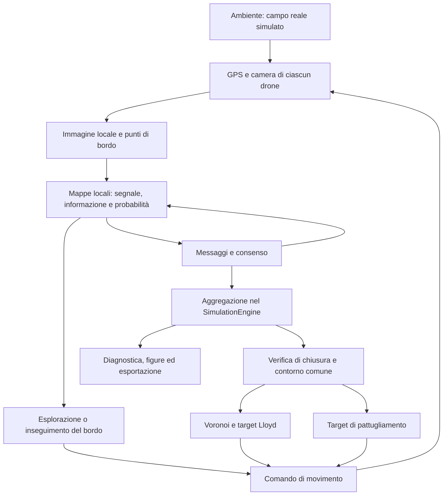
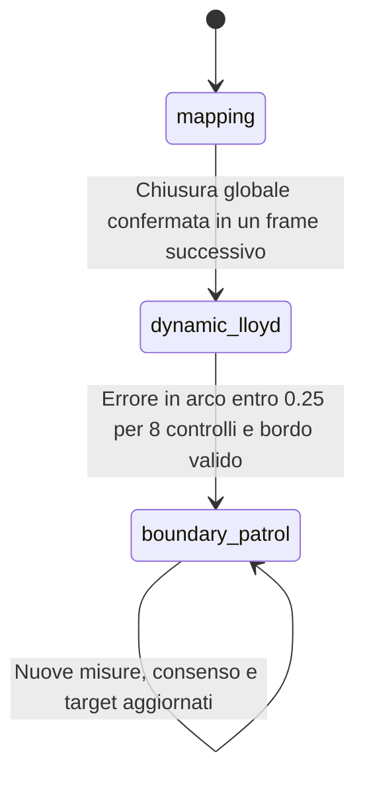

# Distributed Robot Perception: mappatura e monitoraggio di una macchia di petrolio

Questo progetto simula un gruppo di droni che osserva un campo bidimensionale rappresentativo di una macchia di petrolio, costruisce mappe locali, scambia informazioni e si distribuisce lungo il contorno ricostruito. La missione implementata segue tre fasi: **mapping → dynamic Lloyd → boundary patrol**.

Il collegamento con il corso di *Distributed Robot Perception* è il ciclo fra percezione, comunicazione e azione: ogni robot acquisisce misure parziali e rumorose; il consenso diffonde le informazioni; la mappa risultante guida nuove osservazioni e il controllo cooperativo.

Questa guida descrive il comportamento del codice presente nel repository. Le formule spiegano le operazioni implementate; gli esperimenti suggeriti sono distinti dai risultati effettivamente verificati. È una simulazione didattica in Python, con cinematica planare e comunicazioni ideali. Non contiene un simulatore fluidodinamico, una piattaforma ROS o un sistema di volo reale.

## Indice

1. [Avvio e dipendenze](#1-avvio-e-dipendenze)
2. [Architettura e flusso dei dati](#2-architettura-e-flusso-dei-dati)
3. [Coordinate, griglie e unità](#3-coordinate-griglie-e-unità)
4. [Modello della macchia](#4-modello-della-macchia)
5. [Sensori ed estrazione del bordo](#5-sensori-ed-estrazione-del-bordo)
6. [Mappa probabilistica locale](#6-mappa-probabilistica-locale)
7. [Comunicazione e consenso](#7-comunicazione-e-consenso)
8. [Controllo durante la mappatura](#8-controllo-durante-la-mappatura)
9. [Chiusura e macchina a stati](#9-chiusura-e-macchina-a-stati)
10. [Voronoi geodetico e Lloyd](#10-voronoi-geodetico-e-lloyd)
11. [Pattugliamento e dimenticanza](#11-pattugliamento-e-dimenticanza)
12. [Ordine di un passo di simulazione](#12-ordine-di-un-passo-di-simulazione)
13. [Parametri e configurazione](#13-parametri-e-configurazione)
14. [Output e interpretazione delle figure](#14-output-e-interpretazione-delle-figure)
15. [Test e verifiche](#15-test-e-verifiche)
16. [Esperimenti per il report](#16-esperimenti-per-il-report)
17. [Limiti e sviluppi possibili](#17-limiti-e-sviluppi-possibili)
18. [Struttura del report universitario](#18-struttura-del-report-universitario)

## 1. Avvio e dipendenze

Eseguire i comandi dalla directory che contiene `main.py`. Il repository non contiene un file `requirements.txt` o un ambiente bloccato tramite lockfile.

```bash
python3 -m venv .venv
source .venv/bin/activate
python -m pip install numpy scipy matplotlib contourpy pillow pytest
```

| Pacchetto | Utilizzo |
| --- | --- |
| NumPy | Matrici, coordinate, rumore, consenso e algebra lineare |
| SciPy | Spline, distanza dal bordo tramite `cKDTree`, filtro gaussiano ed erosione |
| Matplotlib | Visualizzazione e salvataggio dei grafici |
| ContourPy | Estrazione di contorni ordinati dalle griglie |
| Pillow | Esportazione GIF |
| pytest | Test automatici |

Alcuni moduli prevedono alternative quando SciPy o ContourPy non sono disponibili, ma il comportamento cambia: per esempio, senza `cKDTree` il campo del poligono diventa binario. Per confronti riproducibili usare tutte le dipendenze indicate.

Prima esecuzione senza finestra e senza GIF:

```bash
python main.py --frames 500 --seed 42 --no-save-gif
```

Esecuzione interattiva con archi Voronoi evidenziati:

```bash
python main.py --visualize --show-2d-voronoi --frames 500 --seed 42 --no-save-gif
```

`--visualize` richiede un display e il supporto Tk di Python per `TkAgg`. In un ambiente senza interfaccia grafica omettere l'opzione: viene usato `Agg`. Il codice tenta un ripiego su `Agg` se la selezione del backend interattivo genera `ImportError`.

Registrazione dell'animazione:

```bash
python main.py --frames 500 --seed 42 --gif-frame-stride 5 --gif-fps 10
```

La GIF è abilitata per impostazione predefinita, anche senza finestra. Richiede rendering e memoria; `--no-save-gif` rende più leggere le prove numeriche. Ridurre i frame può lasciare la missione incompleta: l'esportazione finale richiede almeno tre punti di bordo rilevati.

Per consultare le opzioni:

```bash
python main.py --help
```

## 2. Architettura e flusso dei dati

| File | Responsabilità | Funzioni e classi da leggere |
| --- | --- | --- |
| [main.py](main.py) | Configurazione, creazione degli oggetti, ciclo esterno ed esportazione | `run_simulation`, `_build_parser`, `_save_oil_mapping` |
| [environment.py](environment.py) | Dominio spaziale e campo della macchia | `SimulationMap`, `CircleOilSpill`, `SmoothedPolygonOilSpill` |
| [sensors.py](sensors.py) | GPS, camera e conversione pixel/mondo | `GPSSensor`, `CameraSensor`, `CameraMeasurement` |
| [edge_detection.py](edge_detection.py) | Soglia, filtraggio ed estrazione del bordo | `detect_edges`, `extract_edge_points` |
| [drone.py](drone.py) | Stato del robot, mappe, messaggi e movimento | `Drone.sense`, `update_grid`, `consensus_step`, `action` |
| [controller.py](controller.py) | Esplorazione, tracking, Voronoi e Lloyd | `DroneController`, `Controller.compute_ring_ordering` |
| [simulation_engine.py](simulation_engine.py) | Scheduling, consegna dei messaggi, transizioni e diagnostica | `SimulationEngine.step` |
| [visualization.py](visualization.py) | Figure, pannelli e GIF | `Visualizer.render` |
| [tests/](tests/) | Verifiche delle componenti | Sei moduli di test e `conftest.py` |



Ogni `Drone` possiede un proprio `DroneController`, sensori e copie indipendenti delle mappe. I messaggi sono copie dei dati del mittente: il consenso non legge direttamente la mappa mutabile di un vicino durante l'aggiornamento.

**Distinzione importante:** tutto viene eseguito in un unico processo Python. Il consenso è formulato attraverso scambi locali, ma il motore dispone di tutti i robot. Nella pipeline principale usa una mappa aggregata globale per riconoscere la chiusura, distribuisce un contorno comune a tutti e coordina il pattugliamento. È una simulazione con componenti distribuite e coordinamento centrale, non un'implementazione interamente decentralizzata.

## 3. Coordinate, griglie e unità

Esistono due discretizzazioni differenti:

| Oggetto | Estensione predefinita | Dimensione | Passo |
| --- | --- | --- | --- |
| Campo dell'ambiente | `[-5, 5] × [-5, 5]` | `500 × 500` | `10 / 499 ≈ 0.02004` |
| Mappa di ogni robot | `[-10, 10] × [-10, 10]` | `200 × 200` | `0.1` |

La prima descrive il campo osservabile; la seconda memorizza le stime. I droni sono inizializzati uniformemente nel dominio dell'ambiente e il loro movimento viene limitato a `[-5, 5]²`. Una parte della mappa più ampia può restare sconosciuta.

Le coordinate sono in **unità del mondo simulato**. Non è definita una conversione in metri, né un modello di quota o ottica. La camera usa una finestra di `120 × 120` campioni del campo: il lato è circa `2.4` unità; la distanza fra primo e ultimo centro di pixel è `119 × dx`.

La convenzione degli array è:

```text
field[ix, iy] ↔ x lungo il primo asse, y lungo il secondo
```

`SimulationMap` usa `meshgrid(..., indexing="ij")`. Le immagini delle mappe sono spesso trasposte prima di `imshow`. Nei punti estratti dalla camera, la riga corrisponde all'asse `x` e la colonna all'asse `y`.

Con risoluzione della mappa $r$, una posizione viene convertita in cella tramite:

$$
i_x=\left\lfloor\frac{x-x_{\min}}{r}\right\rfloor,
\qquad i_y=\left\lfloor\frac{y-y_{\min}}{r}\right\rfloor.
$$

Il centro della cella è `(x_min + (ix + 0.5)r, y_min + (iy + 0.5)r)`.

Il raggio di comunicazione in celle fa riferimento alla **griglia dell'ambiente**, non alla mappa dei robot:

$$
R_c=n_{\text{celle}}\frac{|dx|+|dy|}{2}.
$$

Il default CLI di `250` celle corrisponde a circa `5.01` unità. La funzione Python `run_simulation()` e il costruttore del motore hanno invece default `205`, pari a circa `4.11`. Per confrontare CLI e API impostarlo esplicitamente.

## 4. Modello della macchia

### 4.1 Campo scalare e soglia

Il petrolio è rappresentato da un campo $C(x,y)\in[0,1]$. È un segnale sintetico di presenza/concentrazione, senza massa fisica conservata. La camera ne osserva porzioni e aggiunge rumore.

La soglia della pipeline è $\tau=0.6$. Il contorno geometrico usato per generare il campo può essere diverso dall'isolinea $C=0.6$ effettivamente rilevata.

### 4.2 Macchia circolare

Con centro $c$, raggio $R$ e distanza $d=\|p-c\|$, `CircleOilSpill` definisce:

$$
C(p)=
\begin{cases}
1 & d\le R,\\
\exp\left(-\frac{(d-R)^2}{2\sigma^2}\right) & d>R.
\end{cases}
$$

I default costruiti da `main.py` sono centro `(0, 0)`, $R=2$ e $\sigma=0.5$. L'interno è uniforme e l'esterno decade gradualmente. Il bordo alla soglia $\tau$ ha raggio:

$$
R_\tau=R+\sigma\sqrt{-2\ln\tau}.
$$

Per $\tau=0.6$ vale circa `2.505`: non coincide con il raggio geometrico `2`.

### 4.3 Poligono irregolare smussato

`SmoothedPolygonOilSpill`:

1. Genera angoli casuali ordinati e raggi perturbati attorno a `r0`.
2. Combina rumore radiale e armoniche sinusoidali.
3. Limita i raggi a `[0.35 r0, 1.85 r0]`.
4. Interpola una curva periodica con `splprep`/`splev`; se non possibile usa Catmull–Rom.
5. Determina l'interno tramite `matplotlib.path.Path` e mantiene la componente interna più grande, con connettività 4.
6. Approssima la distanza dal bordo campionato con `cKDTree` e costruisce il campo.

Con distanza firmata $d_s$, negativa all'interno:

$$
C(p)=\frac{1}{1+\exp(d_s(p)/w)}.
$$

La distanza è calcolata dai punti campionati, non esattamente dai segmenti della curva continua. Il bordo geometrico corrisponde approssimativamente a `C = 0.5`; `C = 0.6` si trova più internamente.

La larghezza della transizione è `w = r0 × (0.10 + 0.22 × smoothness)`, moltiplicata per `0.8` quando `continuous=False`. **`--polygon-continuous` modifica quindi la morbidezza della transizione**: con SciPy disponibile il campo è continuo anche senza questa opzione.

### 4.4 Traslazione ed espansione

`--dynamic-move v` imposta il modulo di una velocità costante; la direzione viene estratta una volta dal seed. `--dynamic-expand e` imposta una velocità di aumento del raggio. Sono accettati anche gli alias con underscore.

$$
c_{k+1}=c_k+v\,dt,\qquad R_{k+1}=R_k+e\,dt.
$$

Nel poligono vengono traslati vertici e campioni del contorno. L'espansione applica una scala uniforme rispetto al centro e aggiorna anche `r0`. Non sono modellati correnti variabili, diffusione, separazione in più macchie o conservazione della massa. La macchia può uscire dall'area osservabile: non rimbalza sui limiti del dominio.

## 5. Sensori ed estrazione del bordo

### 5.1 GPS

Per la posizione fisica $p_i$ il GPS restituisce:

$$
\hat p_i=p_i+\epsilon_i,\qquad
\epsilon_i\sim\mathcal N(0,\sigma_{GPS}^2I_2).
$$

Il default configurato in `main.py` è `σ_GPS = 0.03`. Le stime vengono aggiornate più volte durante un frame: non esiste un'unica misura GPS comune a tutte le operazioni del frame.

Per i droni dotati di GPS il controllore richiede una stima finita; non ripiega silenziosamente sulla posizione reale se manca. Gli oggetti semplificati dei test, privi di sensori, possono invece fornire direttamente la posizione.

### 5.2 Camera

`Drone.sense()` acquisisce il GPS e richiede una finestra del campo centrata sulla **posizione stimata**. Il modello usa quindi il GPS anche per scegliere la zona campionata: non separa una camera fisicamente centrata sulla posizione reale da un errore di georeferenziazione successivo.

La camera:

1. Converte la posizione in indici della griglia del campo.
2. Estrae la finestra e aggiunge zeri fuori dal dominio.
3. Aggiunge rumore gaussiano, con deviazione standard `0.03` nella configurazione principale.
4. Limita i valori a `[0, 1]`.
5. Calcola `oil_fraction`, frazione di pixel almeno pari a `τ`.
6. Rileva il contorno e converte i pixel rilevati in coordinate mondo.

`CameraMeasurement` contiene `image`, `edge_points` e `oil_fraction`. Quest'ultima è diagnostica; l'aggiornamento della mappa usa l'intera immagine.

### 5.3 Rilevamento dei bordi

`detect_edges()` non usa Canny. Il procedimento è:

1. Restituisce nessun bordo se l'immagine è invalida o ha escursione `max − min < 0.15`.
2. Applica un filtro gaussiano con `sigma = 1` nel percorso standard, se SciPy è disponibile.
3. Costruisce `M = (immagine_filtrata ≥ τ)`.
4. Erode la maschera e restituisce `M XOR erosione(M)`.

L'erosione considera vero il bordo esterno per evitare di interpretare automaticamente il margine della finestra come contorno. Il padding a zero della camera può comunque introdurre discontinuità vicino ai confini del dominio.

`apply_blur=False` evita il filtraggio aggiuntivo nella camera, ma non il filtro interno al rilevatore dei bordi. `edge_threshold1` e `edge_threshold2` della camera sono residui dell'interfaccia: il percorso attuale usa `occupancy_threshold`.

I pixel $(r,c)$ sono trasformati usando il centro GPS arrotondato alla griglia:

$$
x=x_{centro}+(r-(H-1)/2)dx,\qquad
y=y_{centro}+(c-(W-1)/2)dy.
$$

Con dimensioni pari, come `120`, il centro geometrico è fra due pixel, mentre l'estrazione parte da un indice intero. È una convenzione di mezzo pixel da considerare nei confronti geometrici precisi.

`last_nls_points` è una copia dei punti di bordo: non viene eseguito un algoritmo di *nonlinear least squares*. `--show-nls-points` visualizza questi campioni senza effettuare un fitting NLS.

## 6. Mappa probabilistica locale

### 6.1 Le quattro matrici

| Attributo | Simbolo | Significato | Valore iniziale |
| --- | --- | --- | --- |
| `occupancy_signal_grid` | $S_i$ | Segnale di occupazione pesato dall'informazione | `0` |
| `information_grid` | $I_i$ | Peso dell'evidenza disponibile | `0` |
| `grid` | $P_i$ | Stima di occupazione | `0.5` |
| `boundary_grid` | $B_i$ | Maschera del bordo dedotto dalla mappa | `0` |

La probabilità viene ricostruita cella per cella:

$$
P_i(c)=
\begin{cases}
S_i(c)/I_i(c) & I_i(c)>10^{-12},\\
0.5 & \text{altrimenti}.
\end{cases}
$$

Il risultato è limitato a `[0, 1]`. `I_i` è un peso algoritmico, non una matrice di Fisher, una covarianza o un conteggio cumulativo di misure indipendenti.

Due celle possono avere entrambe `P = 0.5` ma significati differenti: una mai osservata (`I = 0`), l'altra con evidenze contrastanti (`I > 0`). Per distinguerle occorre conservare anche `I`.

### 6.2 Aggiornamento dalla camera

Nel percorso principale `update_grid()` usa `last_camera_image`, non soltanto i punti di bordo. I pixel validi vengono proiettati nella griglia più grossolana. Per una cella $c$:

$$
z_i(c)=\frac{\#\{\text{pixel in }c\text{ con valore}\ge\tau\}}
{\#\{\text{pixel validi in }c\}}.
$$

Nelle celle osservate:

$$
S_i(c)\leftarrow z_i(c),\qquad I_i(c)\leftarrow1.
$$

Nelle altre celle restano i valori precedenti. I pixel fuori dall'area del campo sono esclusi dall'aggiornamento.

È una **sovrascrittura locale con la misura corrente**, seguita dal consenso. Non è un aggiornamento bayesiano a log-odds e non accumula indefinitamente le misure. “Probabilistica” descrive una stima in `[0, 1]`; non implica un posterior esatto basato su un modello completo del sensore.

Se manca l'immagine esiste un percorso di compatibilità che inserisce i soli punti con `S = I = 1`. Non è il percorso ordinario della camera. I parametri `alpha` e `point_radius_cells` passati a `update_grid()` vengono ignorati.

### 6.3 Bordo dedotto dalla mappa

Una cella appartiene a `boundary_grid` quando:

- è conosciuta: `I > 10^-12`;
- è occupata: `P ≥ 0.6`;
- ha almeno una cella conosciuta e libera fra gli otto vicini.

La sola frontiera tra petrolio e zona sconosciuta non basta. Questo limita i falsi contorni dovuti alla mancanza di osservazioni, ma richiede di osservare entrambi i lati del bordo.

`last_mapped_boundary_points` contiene i centri delle celle della maschera. Viene ricalcolato anche dopo il consenso e può quindi includere evidenze di altri robot.

## 7. Comunicazione e consenso

### 7.1 Grafo di comunicazione

In modalità `range-based`, due droni sono vicini se la distanza euclidea tra le stime GPS non supera `R_c`. La distanza lungo il contorno viene usata per Voronoi, non per la radio.

Con `--fully-connected`, ogni drone riceve da tutti gli altri. Se vengono passati entrambi i flag `--fully-connected` e `--range-based`, prevale `--range-based`.

Non sono modellati latenza, perdita di pacchetti, capacità del canale o interferenze. Le stime GPS non cambiano durante il blocco di round di consenso di un frame.

### 7.2 Messaggi sincroni

`create_consensus_message()` copia `sender_id`, `grid`, `signal_grid` e `information_grid`. Prima di aggiornare un qualsiasi drone, il motore acquisisce tutti i messaggi e determina le consegne.

Ogni round usa uno snapshot comune: l'ultimo robot nel ciclo non può utilizzare il risultato appena aggiornato del primo. È un aggiornamento sincrono di tipo Jacobi.

### 7.3 Equazioni del consenso

Con vicinato $N_i$ e grado $d_i=|N_i|$, per ogni cella:

$$
S_i^{\ell+1}=\frac{S_i^\ell+\sum_{j\in N_i}S_j^\ell}{d_i+1},
\qquad
I_i^{\ell+1}=\frac{I_i^\ell+\sum_{j\in N_i}I_j^\ell}{d_i+1}.
$$

Si ricostruisce poi $P_i=S_i/I_i$. Una cella sconosciuta invia `(S, I) = (0, 0)` e non introduce un voto artificiale pari a `0.5`.

| Evidenza iniziale di due robot connessi | Dopo un round |
| --- | --- |
| A vede petrolio `(1, 1)`, B non sa nulla `(0, 0)` | Entrambi: `(0.5, 0.5)`, dunque `P = 1` |
| A vede petrolio `(1, 1)`, B vede acqua `(0, 1)` | Entrambi: `(0.5, 1)`, dunque `P = 0.5` |

Un drone isolato mantiene i propri valori. Con grafo completo, un round rende uguali le mappe rispetto agli snapshot di quel round; nuove misure possono introdurre nuove differenze.

### 7.4 Significato della convergenza

Per un grafo fisso, connesso e non orientato, la matrice di aggiornamento ha righe a somma uno e include il peso su sé stessi. L'iterazione tende a un valore comune. Pesi uniformi sul vicinato non garantiscono però una matrice doppiamente stocastica.

Nel grafo fisso il peso stazionario è proporzionale a $d_i+1$. Per una cella con informazione complessiva positiva:

$$
P_\infty=\frac{\sum_i\pi_iS_i^0}{\sum_i\pi_iI_i^0},
\qquad \pi_i\propto d_i+1.
$$

Pertanto “average consensus” non significa necessariamente media aritmetica uniforme delle osservazioni iniziali. La media uniforme si ottiene in casi come il grafo completo o regolare. Durante la missione il grafo cambia, le misure riscrivono le celle e i round sono finiti: il risultato del caso statico non prova la convergenza dell'intera simulazione.

Con grafo disconnesso, componenti diverse possono mantenere mappe differenti. Un successivo contatto può diffondere informazioni accumulate in precedenza.

### 7.5 Mappa aggregata e disaccordo

`compute_mean_grid()` calcola:

$$
\bar P(c)=\frac{\sum_i S_i(c)}{\sum_i I_i(c)},
$$

con valore `0.5` in assenza di informazione significativa. Non coincide in generale con la media aritmetica delle $P_i$.

La metrica registrata è:

$$
E=\frac1N\sum_{i=1}^N\|P_i-\bar P\|_F.
$$

Per una matrice 2D, la norma NumPy usata qui è la norma di Frobenius. L'errore non è normalizzato per il numero di celle e dipende dalla risoluzione e dalle dimensioni della mappa.

**Un errore nullo indica mappe uguali, non mappe corrette.** Tutti i robot potrebbero concordare su una zona sconosciuta o su un errore comune. Non viene calcolata automaticamente un'accuratezza rispetto alla ground truth.

## 8. Controllo durante la mappatura

`DroneController._mapping_action()` sceglie fra tre comportamenti:

| Modalità | Condizione | Azione |
| --- | --- | --- |
| `explore` | Nessun target utile | Direzione memorizzata, inizialmente casuale |
| `consensus_seek` | Target in mappa, tracking non disponibile | Moto verso il punto di mappa più vicino |
| `boundary_tracking` | Punti di bordo utilizzabili | Stima della tangente e inseguimento |

L'esplorazione non estrae una nuova direzione a ogni frame. Senza nuove informazioni un drone può arrivare al limite del dominio e restare bloccato dal clipping. Non esiste un pianificatore sistematico di copertura.

La ricerca del target preferisce `boundary_grid`; se è vuota usa le celle occupate di `grid`. I punti utilizzabili comprendono `last_mapped_boundary_points`, che può contenere informazioni ricevute tramite consenso.

Per seguire il bordo:

1. Si trova il punto più vicino alla posizione stimata.
2. Si centrano fino a 16 punti vicini e si applica SVD.
3. La prima direzione principale stima la tangente locale.
4. Si sceglie il verso coerente con la tangente precedente o il moto.
5. Si filtra la tangente con peso `0.75` sul valore precedente.
6. Si combinano avanzamento tangenziale, correzione normale e punto di anticipazione.

Con tangente unitaria $t$, errore normale $e_n$ e vettore verso il punto di anticipazione $e_a$:

$$
u=0.08\,t+0.85\,e_n+0.30\,e_a.
$$

La norma di $e_n$ è limitata a `0.07`. Il punto di anticipazione è cercato intorno alla distanza `0.45`; in assenza di candidati si usa un vettore tangenziale di quella lunghezza. Il comando finale è saturato a norma `0.12`.

Esiste un ripiego basato sul gradiente Sobel dell'immagine e sull'errore rispetto alla soglia. Nel flusso ordinario il tracking viene però tentato in presenza di punti utilizzabili; il ripiego serve soprattutto quando il comando dalla nuvola non può essere costruito.

Il campo globale viene passato all'interfaccia del controllo in mapping, ma `_boundary_tracking_action()` lo scarta: usa camera memorizzata e punti di mappa. Un argomento presente nella firma non implica che la ground truth sia usata direttamente per guidare il robot.

## 9. Chiusura e macchina a stati



Questa è la pipeline selezionata da `SimulationEngine.step()`. `dynamic_lloyd` viene usato anche con macchia statica: il nome riguarda l'aggiornamento del contorno durante il controllo.

### 9.1 Verifica della chiusura

Il motore costruisce il bordo della mappa globale aggregata e chiama `_dfs_polygon_closure_check()`:

1. Considera barriera le celle di bordo sopra soglia.
2. Esegue flood fill con vicini a 4 dalla cella `(0, 0)`.
3. Considera racchiuse le celle non di bordo che il flood fill non raggiunge.
4. Richiede almeno `250` celle racchiuse, valore configurabile.
5. Estrae il contorno con ContourPy e sceglie la linea più lunga.
6. Richiede almeno `24` punti e segmenti, inclusa la chiusura, non più lunghi di `3 × resolution = 0.3`.

Con risoluzione `0.1`, 250 celle corrispondono a circa `2.5` unità quadrate. È un filtro contro piccole chiusure spurie, non una stima dell'area reale totale.

`enclosed_false_cells` indica celle false **nella maschera del bordo**: possono essere l'interno della macchia. Non significa “acqua libera dentro il petrolio”.

Se l'estrazione principale non riesce, si tenta una linea costruita raggruppando i punti per angolo rispetto al centro e mediando ogni gruppo. Il ripiego è meno generale per geometrie molto concave.

Il flood fill parte dal solo `(0, 0)`, assumendo che rappresenti l'esterno accessibile; non viene inizializzato da tutto il perimetro. La mappa standard è più ampia dell'ambiente, ma questa assunzione va rivalutata cambiando dominio.

### 9.2 Conferma e transizione

Alla prima chiusura viene memorizzato `_pending_lloyd_transition_frames["all"]`. Se il bordo resta chiuso in un frame successivo, tutti i droni passano a `dynamic_lloyd`; se la chiusura scompare, la candidatura è cancellata.

Fra le verifiche passa almeno un nuovo blocco di consenso, ma non necessariamente una nuova acquisizione della camera. Il contorno viene copiato nei controllori di tutti i robot.

Successivamente il motore tenta di aggiornarlo dalla mappa globale. Se non trova una nuova chiusura valida resta disponibile l'ultimo contorno accettato. Non esiste un ritorno generale a mapping dopo la perdita del bordo.

Sono presenti funzioni per lo stato `lloyd` e transizioni di singoli droni, coperte da alcuni test. Non sono la sequenza principale: `_check_decentralized_mapping_transitions()`, nonostante il nome, esegue una verifica globale e una transizione collettiva.

## 10. Voronoi geodetico e Lloyd

### 10.1 Coordinate lungo il bordo

Il contorno è una polilinea chiusa $q_0,\ldots,q_{M-1}$. La somma delle lunghezze dei segmenti, incluso l'ultimo verso $q_0$, è $L$. La coordinata curvilinea $s\in[0,L)$ rappresenta la distanza percorsa sulla polilinea.

La posizione GPS viene proiettata sul segmento più vicino, ottenendo `boundary_s` e `boundary_index`. `update_boundary_projection()` aggiorna queste coordinate senza modificare la posizione fisica. Esiste una funzione separata `project_drone_to_boundary()` che sposta direttamente il drone sul contorno, ma non è l'operazione usata dal ciclo principale a ogni frame.

### 10.2 Scambio multi-hop

Prima del calcolo dei target, ogni drone inizializza le conoscenze con posizione e arco correnti. Il motore simula fino a `N` round di inoltro ai vicini.

Su un grafo connesso l'informazione può attraversare più archi nello stesso passo simulato; su un grafo disconnesso resta nella componente. Le conoscenze sono ricostruite a ogni scambio e la posizione corrente del robot non viene sovrascritta da copie ricevute.

Questo scambio è distinto dal consenso sulle mappe; non viene simulato il tempo reale necessario ai vari hop.

### 10.3 Multi-Source Shortest Path

Il bordo viene trattato come un grafo: campioni come nodi e segmenti consecutivi come archi pesati dalla lunghezza geometrica. Un bordo chiuso collega l'ultimo nodo al primo.

`multi_source_shortest_path_voronoi()` applica Dijkstra con più sorgenti, una per robot noto al controllore. Assegna ogni campione alla sorgente più vicina **lungo il bordo**:

$$
V_i=\{q:d_\Gamma(q,p_i)\le d_\Gamma(q,p_j)\text{ per gli altri robot noti}\}.
$$

Su un anello:

$$
d_\Gamma(s_a,s_b)=\min(|s_a-s_b|,L-|s_a-s_b|).
$$

È Voronoi unidimensionale geodetico, non una partizione di tutta la superficie. Punti vicini nel piano, su lati opposti di una concavità, possono essere lontani lungo il contorno.

Dijkstra assegna i campioni discreti; i target sono calcolati separatamente dalle coordinate curvilinee continue. Non sono medie dei soli pixel assegnati. Se più sorgenti coincidono sullo stesso campione, il confronto stretto delle distanze può lasciare l'etichetta alla prima sorgente inserita.

### 10.4 Target Lloyd

Ordinati i robot sull'anello:

$$
g_i^-=(s_i-s_{i-1})\bmod L,\qquad
g_i^+=(s_{i+1}-s_i)\bmod L.
$$

La cella comincia a metà del gap precedente e termina a metà del successivo. Per densità uniforme il centro in coordinata d'arco è:

$$
s_i^*=\left(s_i+\frac{g_i^+-g_i^-}{4}\right)\bmod L.
$$

Il target cartesiano è ottenuto interpolando la polilinea in $s_i^*$. `target_centroid` è un centro **lungo l'arco**, non un baricentro cartesiano che potrebbe cadere lontano dal contorno.

Esempio: con bordo di lunghezza `20` e robot a `s = 0, 4, 12`, il robot a `4` ha gap precedente `4` e successivo `8`. Il suo target è `4 + (8 − 4)/4 = 5`: si muove verso la parte meno coperta.

Il comando è:

$$
u_i=\operatorname{sat}_{0.12}\left(k_t(q(s_i^*)-\hat p_i)\right),\qquad k_t=1.
$$

È un comando cartesiano verso un target sul bordo. Il percorso intermedio può tagliare una curva: non è imposto un vincolo cinematico tangente alla polilinea.

Il riferimento teorico è una copertura a densità uniforme che riduce le distanze lungo il contorno. L'equidistanza è desiderata; rumore, saturazione, discretizzazione, disconnessioni e variazione del bordo non permettono di dedurne una garanzia per ogni esecuzione.

### 10.5 Completamento di Lloyd

Il motore verifica il massimo errore curvilineo fra proiezione e target. Se non supera `0.25` per `8` controlli consecutivi, tenta il passaggio a patrol richiedendo di nuovo un bordo chiuso valido.

Il criterio riguarda la coordinata lungo l'arco: non misura direttamente distanza normale del drone dal contorno o accuratezza della mappa rispetto al campo vero.

## 11. Pattugliamento e dimenticanza

### 11.1 Target mobili

Il motore ordina globalmente i robot sul bordo e fa avanzare un riferimento comune con velocità `0.05`:

$$
s_{ref}\leftarrow(s_{ref}+v_{patrol}dt)\bmod L.
$$

Il target base del robot con indice $i$ è:

$$
s_i^{base}=(s_{ref}+iL/N)\bmod L.
$$

Con più di due droni viene aggiunta una correzione basata sui gap anteriore e posteriore:

$$
v_i=\operatorname{clip}\left(0.05+0.08(d_{front}-d_{back}),0.01,0.10\right).
$$

La differenza rispetto alla velocità base modifica il target. L'offset è limitato a un quarto della spaziatura `L/N`. Il comando fisico resta proporzionale all'errore cartesiano e saturato alla velocità massima.

L'ordine viene mantenuto finché l'insieme dei robot resta uguale. I target dipendono da dati globali del motore, anche se continua lo scambio multi-hop delle posizioni.

### 11.2 Forgetting

Solo in `boundary_patrol`, prima delle nuove misure:

$$
P_i\leftarrow\alpha P_i+(1-\alpha)0.5,\qquad
I_i\leftarrow\alpha I_i,\qquad
S_i\leftarrow P_iI_i,
$$

con $\alpha=0.995$.

Le celle non rivisitate perdono confidenza e si avvicinano a `0.5`. Una cella inizialmente a `1`, senza misure nuove né effetti dei vicini, segue $P_k=0.5+0.5\alpha^k$: dopo circa 322 applicazioni scende sotto `0.6`.

Nelle fasi precedenti non si applica questo forgetting. `temporal_alpha` del costruttore del motore viene ignorato e memorizzato come `None`: non controlla il filtro di patrol.

## 12. Ordine di un passo di simulazione

`SimulationEngine.step()` incrementa il frame prima delle operazioni: il primo frame del motore è `1`.

```text
1. Incrementa il frame e decide se acquisire la camera.
2. Aggiorna la macchia e ricostruisce il campo.
3. Aggiorna le stime GPS.
4. Applica forgetting, solo in boundary_patrol.
5. Se previsto, acquisisce camera/GPS e aggiorna le mappe.
6. Esegue i round sincroni di consenso e registra le tracce.
7. Salva disaccordo e mappa aggregata del frame.
8. Verifica la transizione o aggiorna il contorno comune.
9. Calcola i comandi e muove i droni.
10. Verifica il completamento di Lloyd.
```

In mapping, con `measure_every = 3`, le camere acquisiscono ai frame `1, 4, 7, …`. In `dynamic_lloyd` e `boundary_patrol` acquisiscono a ogni frame.

**I 10 round di consenso vengono eseguiti a ogni frame attivo**, compresi quelli senza nuove immagini. Fra due misure in mapping possono quindi esserci 30 round. Alcune stringhe della console parlano di round “per measurement”, ma il ciclo li applica per frame.

La diagnostica precede il movimento. Una figura renderizzata dopo `step()` combina le mappe disponibili con le posizioni successive al comando. La stampa di progresso in `main.py` usa inoltre un contatore esterno che parte da zero, diverso da `engine.frame`.

### Nota su `dt`

`Drone.action()` implementa `p ← p + u × dt`, ma i metodi del motore non gli passano `self.dt`. Il movimento dei droni usa quindi il default `dt = 1.0`, mentre macchia e riferimento patrol usano il `dt` configurato.

**Per esperimenti coerenti con l'implementazione attuale mantenere `--dt 1.0`.** Modificarlo non riscalerebbe uniformemente tutte le dinamiche. La velocità della macchia viene moltiplicata per `dt`, anche se l'help CLI la descrive come velocità per passo.

## 13. Parametri e configurazione

### 13.1 Opzioni CLI

I default seguenti si riferiscono a `python main.py`.

| Opzione | Default | Effetto |
| --- | --- | --- |
| `--frames` | `500` | Numero di chiamate a `step()` |
| `--seed` | `42` | Inizializzazione dei generatori casuali |
| `--num-drones` | `5` | Numero di robot |
| `--visualize` | Disattivata | Finestra interattiva |
| `--oil-shape` | `smoothed_polygon` | `circle` o `smoothed_polygon` |
| `--polygon-vertices` | `36` | Vertici iniziali |
| `--polygon-r0` | `2.5` | Scala del poligono |
| `--polygon-smoothness` | `0.2` | Irregolarità, interpolazione e morbidezza |
| `--polygon-x0`, `--polygon-y0` | `None` | Centro; di default il centro del dominio |
| `--polygon-continuous` | Disattivata | Allarga la transizione del campo |
| `--dynamic-move`, `--dynamic_move` | `None` | Velocità di traslazione; assenza equivale a zero |
| `--dynamic-expand`, `--dynamic_expand` | `None` | Velocità di espansione; assenza equivale a zero |
| `--fully-connected` | Disattivata | Comunicazione fra tutte le coppie |
| `--range-based` | Flag non passato | Forza la modalità a raggio, già predefinita |
| `--communication-radius-cells` | `250` | Raggio in celle della griglia ambiente |
| `--measure-every` | `3` | Intervallo camera nella sola fase mapping |
| `--show-nls-points` | Disattivata | Visualizza i punti di bordo rilevati |
| `--show-2d-voronoi` | Disattivata | Colora gli archi assegnati in fase Lloyd |
| `--dt` | `1.0` | Passo per ambiente e riferimento patrol; vedere la limitazione sopra |
| `--closure-min-enclosed-false-cells` | `250` | Area minima racchiusa per la chiusura |
| `--mapping-point-radius-cells` | `1` | Esposto ma ignorato da `Drone.update_grid()` |
| `--oil-mapping-output` | `./tmp_output/oil_mapping_data.npy` | File dei punti esportati |
| `--no-save-gif` | Non passato | Disabilita una registrazione altrimenti attiva |
| `--gif-filename` | `simulation_animation.gif` | Nome della GIF in `tmp_output` |
| `--gif-fps` | `10.0` | Velocità di riproduzione |
| `--gif-frame-stride` | `1` | Registra un frame ogni N render |

Gli FPS non cambiano il passo della simulazione. I parametri `polygon-*` non configurano il cerchio. Il codice valida o limita alcuni valori ma non tutti: un numero nullo di robot o frame non garantisce un'esportazione valida.

### 13.2 Valori configurati nel codice

| Parametro | Valore principale | Dove intervenire |
| --- | --- | --- |
| Ambiente | `500 × 500`, `[-5, 5]²` | `main._build_environment` |
| Mappa robot | `200 × 200`, passo `0.1`, `[-10, 10]²` | `main._build_engine` |
| Camera | `120 × 120` | `main._build_engine` |
| Soglia | `0.6` | `main._build_engine` |
| Round consenso | `10` per frame | `main._build_engine` |
| Rumore GPS/camera | `0.03` / `0.03` | `main._add_drones` |
| Velocità massima | `0.12` | `Drone` e `DroneController` |
| Velocità esplorazione | `0.08` | `DroneController.__init__` |
| Minimo punti bordo | `24` | `SimulationEngine.__init__` |
| Criterio Lloyd | `0.25`, per `8` controlli | `SimulationEngine.__init__` |
| Velocità patrol | `0.05` | `SimulationEngine.__init__` |
| Forgetting patrol | `0.995` | `SimulationEngine.__init__` |

Non esistono flag CLI per questi valori. Per studi parametrici si può costruire il motore da Python:

```python
import numpy as np
from environment import SimulationMap, CircleOilSpill
from simulation_engine import SimulationEngine

np.random.seed(42)
world = SimulationMap()
spill = CircleOilSpill(radius=2.0)
engine = SimulationEngine(
    sim_map=world,
    oil_spill=spill,
    sensor_size=120,
    communication_radius_cells=250,
    fully_connected=True,
    consensus_rounds=10,
    dt=1.0,
    verbose=False,
)
for i in range(5):
    engine.add_drone(
        f"D{i}",
        x=np.random.uniform(-5, 5),
        y=np.random.uniform(-5, 5),
        gps_noise=0.03,
        camera_noise=0.03,
    )

engine.run(iterations=500)
print(engine.control_state, engine.transition_frame, engine.patrol_start_frame)
print(engine.error_history[-1])
np.save("mean_probability.npy", engine.compute_mean_grid())
np.save("mean_information.npy", engine.compute_mean_information_grid())
```

L'esempio non crea il visualizzatore e permette di accedere ai risultati numerici. `main.run_simulation()` salva i prodotti finali ma non restituisce il motore.

## 14. Output e interpretazione delle figure

### 14.1 File prodotti

L'esecuzione standard scrive in `tmp_output`, relativa alla directory di lavoro:

| File | Contenuto |
| --- | --- |
| `final_simulation_state.png` | Ultimo stato del visualizzatore |
| `consensus_convergence.png` | Disaccordo fra le mappe |
| `final_occupancy_grid.png` | Mappa aggregata finale sogliata |
| `final_occupancy_grid_robot_D0.png`, ecc. | Mappe locali finali sogliate |
| `simulation_animation.gif` | Animazione, se abilitata |
| `oil_mapping_data.npy` | Array `(N, 2)` dei punti di bordo in coordinate mondo |
| `oil_mapping_metadata.json` | Provenienza, coordinate, griglie e dinamica |

Le esecuzioni successive riutilizzano i nomi. Archiviare i risultati di ogni esperimento prima del successivo. `--oil-mapping-output` sposta soltanto i punti e il relativo JSON, non PNG e GIF. Nella directory scelta il JSON mantiene il nome fisso `oil_mapping_metadata.json`.

Le immagini già presenti nel repository, incluse quelle nella directory principale, non documentano necessariamente la configurazione corrente. Per il report associare ogni figura a comando, seed e revisione del codice.

### 14.2 Visualizzatore e mappe

Il pannello principale mostra il campo reale simulato, i robot e le sovrapposizioni delle stime. La ground truth è disponibile al lettore della figura; ciò non significa che venga usata direttamente dal controllore locale.

Il pannello laterale mostra la probabilità aggregata in mapping e patrol. Durante Lloyd mostra la partizione del bordo e i target. `--show-2d-voronoi` colora gli archi sul piano, non celle bidimensionali su tutta la superficie.

I PNG dedicati alle occupancy grid applicano la soglia `0.6`: il bianco include sia acqua sia celle sconosciute a `0.5`. Non permettono di ricostruire probabilità originali o pesi d'informazione. Per discutere l'incertezza usare il pannello probabilistico e salvare anche gli array.

### 14.3 Grafico del consenso

Normalmente contiene una curva per drone. Ogni intervallo orizzontale fra indici di misura raccoglie il valore dopo il sensing e quelli dopo i round fino alla misura successiva. L'asse non rappresenta direttamente secondi o frame di movimento.

Un rialzo dopo il sensing è plausibile: un robot ha informazioni nuove. La diminuzione successiva indica diffusione. Non è richiesto che la curva dell'intera missione sia monotona.

### 14.4 Contorno esportato

`_mapped_boundary_points_from_consensus()` prende le celle del bordo aggregato, le converte nei centri in coordinate mondo e le ordina per angolo rispetto al baricentro. La sorgente dichiarata è `information_weighted_average_consensus_boundary`.

Questo ordinamento è diverso dall'estrazione ContourPy usata per il controllo. Per concavità o componenti multiple può creare salti o collegamenti scorretti. Il file non è necessariamente la polilinea in `engine.closed_boundary_points`.

L'export richiede almeno tre punti e non ripiega sul modello vero della macchia. Non verifica però la chiusura topologica prima di scrivere `closed_boundary: true` e `ordered_boundary: true` nel JSON. Questi campi non certificano la validità geometrica; il primo punto non è necessariamente ripetuto in fondo.

Lettura dei dati:

```python
import json
import numpy as np
import matplotlib.pyplot as plt

points = np.load("tmp_output/oil_mapping_data.npy", allow_pickle=False)
with open("tmp_output/oil_mapping_metadata.json", encoding="utf-8") as file:
    metadata = json.load(file)

print(points.shape, metadata["coordinate_frame"])
plt.scatter(points[:, 0], points[:, 1], s=5)
plt.axis("equal")
plt.xlabel("x [unità di simulazione]")
plt.ylabel("y [unità di simulazione]")
plt.show()
```

Lo scatter mostra i campioni senza presumere una polilinea valida. Il JSON non registra tutti i parametri, per esempio seed, numero di droni e configurazione completa del controllo: conservarli separatamente.

## 15. Test e verifiche

Per eseguire la suite:

```bash
python -m pytest -q
```

Durante la redazione del README è stato eseguito `python3 -m pytest -q -p no:cacheprovider`: **32 test superati**, con 14 avvisi di deprecazione relativi all'integrazione Matplotlib/Pyparsing. Non sono state eseguite campagne comparative o validate statisticamente le prestazioni della missione completa.

Ambiente verificato: Python `3.12.3`, NumPy `1.26.4`, SciPy `1.17.1`, Matplotlib `3.9.2`, ContourPy `1.3.3`, Pillow `11.0.0`, pytest `9.1.1`. Sono versioni osservate, non requisiti minimi o una garanzia per ogni altra combinazione.

| Modulo | Proprietà controllate |
| --- | --- |
| `test_decentralized_consensus.py` | Snapshot ricevuti, celle sconosciute e osservazioni contrastanti |
| `test_controller_boundary_mode.py` | Scelta dell'azione dalla mappa e direzione verso target condivisi |
| `test_dynamic_oil_spill.py` | Traslazione, espansione, direzione riproducibile e validazione della velocità |
| `test_sensor_ground_truth_boundaries.py` | Camera centrata sul GPS, assenza di ripiego sulla posizione vera o sul modello per l'export |
| `test_state_machine_transition.py` | Chiusura, area minima, continuità, funzioni di transizione e target patrol |
| `test_voronoi_mssp_static.py` | Distanze in arco, periodicità, target Lloyd, GPS e scambio multi-hop |

I test sono principalmente unitari o su scenari sintetici. Il loro superamento non dimostra che ogni seed completi la missione, che i droni evitino collisioni o che possano inseguire una macchia arbitrariamente veloce. Alcuni test riguardano anche funzioni di compatibilità fuori dalla pipeline principale.

## 16. Esperimenti per il report

### 16.1 Scenari riproducibili

Baseline con cerchio statico e comunicazione completa:

```bash
python main.py --oil-shape circle --fully-connected --num-drones 5 --frames 500 --seed 42 --dt 1 --no-save-gif
```

Confronto del raggio di comunicazione sullo stesso scenario:

```bash
python main.py --oil-shape circle --range-based --communication-radius-cells 100 --num-drones 5 --frames 500 --seed 42 --dt 1 --no-save-gif
python main.py --oil-shape circle --range-based --communication-radius-cells 250 --num-drones 5 --frames 500 --seed 42 --dt 1 --no-save-gif
```

Geometria irregolare:

```bash
python main.py --oil-shape smoothed_polygon --polygon-vertices 36 --polygon-r0 2.5 --polygon-smoothness 0.2 --fully-connected --frames 500 --seed 42 --dt 1 --no-save-gif
```

Campo mobile e in espansione:

```bash
python main.py --oil-shape circle --fully-connected --dynamic-move 0.001 --dynamic-expand 0.0005 --frames 500 --seed 42 --dt 1 --no-save-gif
```

Sono protocolli proposti, non esecuzioni di cui qui si attestano risultati o completamento. Ripeterli su più seed, modificare un fattore per volta e archiviare separatamente gli output. Nei poligoni, cambiare seed cambia anche geometria: per isolare il rumore occorre separare i generatori o fissare la geometria via API.

### 16.2 Metriche da distinguere

| Domanda | Metrica | Disponibilità |
| --- | --- | --- |
| I robot concordano? | `E` e tracce per drone | Già calcolate |
| Quando viene riconosciuta la chiusura? | `transition_frame` | Nell'oggetto motore |
| Quando inizia patrol? | `patrol_start_frame` | Nell'oggetto motore |
| Quanta area è stata osservata? | Celle con informazione sopra una soglia scelta | Da calcolare dagli array |
| La regione occupata è corretta? | IoU, precision/recall rispetto al campo sogliato | Da implementare |
| Il contorno è corretto? | Distanza media simmetrica o Hausdorff | Da implementare |
| La distribuzione è uniforme? | Scarto dei gap da `L/N` | Da calcolare dagli archi |
| Il drone resta vicino al bordo? | Distanza normale dal contorno stimato e vero | Da implementare |
| Quanto costa la collaborazione? | Messaggi, byte, round e tempo di calcolo | Da strumentare |

Per confrontare con la ground truth usare la stessa soglia `0.6` e allineare coordinate e risoluzioni. Nel cerchio il riferimento osservato è l'isolinea della sezione 4, non il cerchio geometrico di raggio `2`.

Per maschere già allineate $A$ e $B$:

$$
IoU=\frac{|A\cap B|}{|A\cup B|}.
$$

Dichiarare come si trattano celle sconosciute e regioni fuori dall'ambiente. Valutare tutto `[-10, 10]²` senza distinguerle può essere fuorviante. Per la copertura informativa scegliere e dichiarare una soglia su `I`: il solo `I > 10^-12` può includere evidenze deboli diffuse dal consenso.

Per l'equidistanza, ordinare gli archi e includere il gap di chiusura:

$$
e_{spacing}=\sqrt{\frac1N\sum_i(g_i-L/N)^2}.
$$

Riportare numero di seed, media, dispersione, budget di frame e casi non completati. Un mancato ingresso in patrol entro il budget è un risultato da registrare, non una prova da eliminare.

## 17. Limiti e sviluppi possibili

### 17.1 Limiti implementativi

- **Coordinamento globale:** chiusura, contorno comune, completamento e target patrol dipendono dal motore. Anche componenti radio separate possono ricevere il contorno attraverso questa logica.
- **Comunicazione ideale:** non si penalizzano griglie complete, ritardi o multi-hop. Un messaggio contiene tre matrici `float64` da `200 × 200`, circa `960000` byte grezzi senza overhead: è una stima della dimensione dei dati, non traffico misurato.
- **Memoria:** le quattro matrici principali richiedono circa `1.28 MB` decimali per drone. `mean_grid_history` conserva circa `160 MB` per 500 frame con mappe `200 × 200` in `float64`. Snapshot, grafici e GIF aggiungono memoria; disabilitare la GIF non disabilita questa cronologia.
- **Fusione semplificata:** sovrascrittura delle celle osservate, pesi uniformi sui vicini e nessuna gestione esplicita delle correlazioni delle informazioni inoltrate.
- **Esplorazione incompleta:** direzione persistente e clipping non garantiscono l'incontro con la macchia o la copertura del contorno.
- **Robot idealizzati:** nessun modello di accelerazione, orientamento, quota, inerzia, consumo, ostacoli o collision avoidance; `dt` non viene propagato uniformemente.
- **Sensori idealizzati:** GPS senza bias persistente e camera senza prospettiva, illuminazione od occlusioni; la posizione GPS determina anche il campionamento.
- **Contorno singolo:** viene privilegiata una linea chiusa lunga. Più macchie, buchi e cambi di topologia non hanno una gestione generale.
- **Riferimento precedente:** se non è ricostruibile una nuova chiusura, può restare in uso il vecchio contorno, senza una strategia completa di recupero.
- **Export geometrico:** ordinamento angolare e flag non validati possono non bastare per usare i punti come poligono affidabile.
- **Parametri inattivi:** `mapping_point_radius_cells` e `temporal_alpha` non producono gli effetti suggeriti dalle interfacce.
- **Riproducibilità degli artefatti:** metadati incompleti e nomi riutilizzati fra esecuzioni richiedono una registrazione esterna della configurazione.

Un round sulle griglie ha costo proporzionale al numero di celle e ai vicinati da fondere; su grafi densi diventa oneroso. Il nucleo Dijkstra opera su una catena/anello di `M` nodi con costo indicativo `O(M log M)`. Proiezioni, elaborazione per robot, ricostruzione del campo e rendering aggiungono altri costi: queste stime non sono misure del tempo totale.

### 17.2 Estensioni possibili

Le estensioni più dirette sono: passare `dt` a tutte le azioni; separare camera fisica ed errore di localizzazione; introdurre pianificazione esplorativa; rendere locali chiusura e aggiornamento del bordo; simulare ritardi e perdite; scambiare sole celle modificate; confrontare pesi di consenso che preservano la media uniforme; gestire l'invecchiamento dell'informazione anche prima di patrol; validare topologia e ordine del contorno esportato.

Per una valutazione scientifica servono inoltre salvataggio delle matrici complete, configurazioni per esperimento, metriche rispetto alla ground truth e campagne su più seed. Sono proposte, non funzionalità già implementate.

### 17.3 Problemi pratici frequenti

| Sintomo | Interpretazione e verifica |
| --- | --- |
| Errore relativo a Tk/display | Omettere `--visualize` e usare la modalità senza finestra |
| GIF lenta o memoria elevata | Usare `--no-save-gif`; lo stride riduce i frame conservati, ma il rendering viene comunque richiesto |
| Export con meno di tre punti | Non ci sono abbastanza punti dal bordo aggregato; controllare durata, geometria, camera e osservazioni |
| Il drone resta al limite della mappa | L'esplorazione persiste nella direzione e il movimento è limitato dal dominio |
| Nessun passaggio a Lloyd | Bordo incompleto, informazione insufficiente sui due lati o criteri di area/continuità non soddisfatti |
| Disaccordo quasi nullo ma mappa incompleta | Consenso raggiunto anche su celle sconosciute: verificare `information_grid` |
| Risultati inattesi cambiando `dt` | Ambiente e movimento del drone non usano lo stesso passo configurato |
| Modificare il raggio dei punti non cambia la mappa | `mapping_point_radius_cells` è ignorato dall'aggiornamento corrente |

## 18. Struttura del report universitario

Una struttura coerente con il progetto:

1. **Problema e obiettivo:** ricostruire e monitorare un fenomeno esteso da osservazioni locali.
2. **Ipotesi:** piano 2D, frame globale comune, sensori rumorosi, campo sintetico, comunicazioni ideali e operazioni globali.
3. **Architettura:** moduli, stato locale, dati scambiati e responsabilità del simulatore.
4. **Percezione e mappatura:** camera, soglia, coordinate, matrici `S/I/P`, incertezza e bordo.
5. **Fusione distribuita:** consenso, condizioni del caso statico, connettività e differenza fra accordo e accuratezza.
6. **Controllo cooperativo:** mapping, chiusura, Voronoi geodetico, Lloyd e pattugliamento.
7. **Protocollo sperimentale:** configurazioni, seed, versioni, metriche e budget.
8. **Risultati:** grafici, mappe, contorni, tempi di transizione e casi non completati, usando soltanto misure raccolte.
9. **Discussione:** limiti e differenze fra modello teorico e implementazione.
10. **Conclusioni e sviluppi:** risultati sostenuti dalle osservazioni e proprietà da verificare ulteriormente.

Domande utili per preparare l'esposizione:

- Perché si scambiano separatamente segnale e informazione invece di mediare soltanto le probabilità?
- Perché `P = 0.5` può indicare sia assenza di osservazioni sia conflitto?
- Quando il consenso preserva la media aritmetica e quando introduce pesi diversi?
- Perché usare una distanza geodetica per coprire un bordo?
- Che differenza c'è fra centro in coordinata d'arco e baricentro cartesiano?
- Quali decisioni sono locali e quali dipendono dal motore globale?
- Perché `E ≈ 0` non dimostra una ricostruzione corretta?
- Che cosa accade con bordo aperto, grafo disconnesso o macchia fuori dal dominio?

Per seguire il codice leggere prima `main.run_simulation()` e `SimulationEngine.step()`, poi `Drone.sense()` e `Drone.update_grid()`, quindi `Drone.consensus_step()` e infine i metodi di mapping, chiusura e Voronoi/Lloyd. I test offrono piccoli esempi per verificare il significato delle singole operazioni.

La bibliografia della relazione dovrà affiancare al codice fonti teoriche effettivamente consultate su occupancy mapping, consenso multi-agente, copertura di Lloyd e cammini minimi. Questo README non attribuisce al progetto risultati sperimentali o garanzie teoriche non dimostrati.
